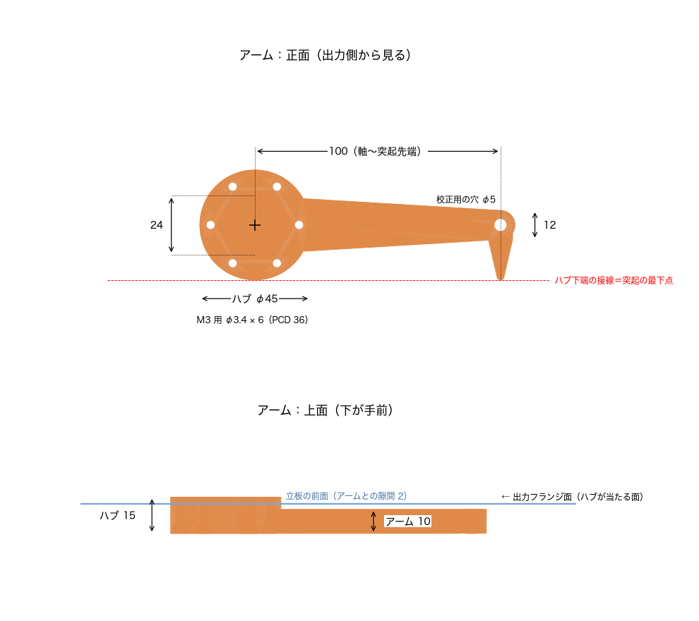
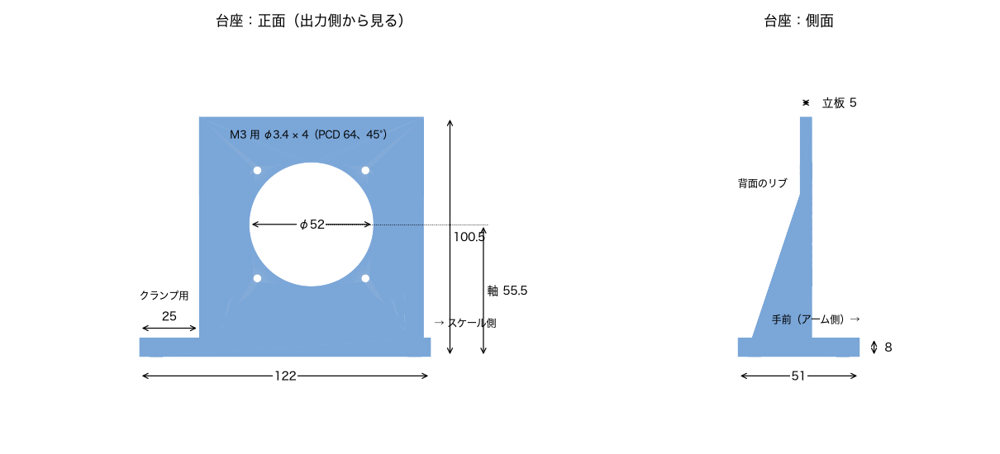

# QDD トルク測定治具

自作 QDD（準ダイレクトドライブ）モーターの出力トルクを、キッチンスケールで測るための 3D プリント治具。
モーターを台座に固定し、出力フランジに取り付けたアームの先端でキッチンスケールの皿を押す。
スケールの表示値とアームの長さ（軸から 100 mm）からトルクを求める。

主な用途は、静止状態で出せるトルク（ストールトルク）の測定と、電流とトルクの関係の確認である。
アームは皿に当たって止まるので、モーターを回転させながら測ることはできない。

## ファイル構成

| ファイル | 内容 |
|---|---|
| `jig.py` | build123d による形状定義。寸法はすべて冒頭のパラメーターで変更できる |
| `out/arm.stl` | アーム（印刷向きに配置済み） |
| `out/base.stl` | 台座 |
| `out/assembly.step` | 組立確認用（台座、アーム、モーターとスケールのダミー） |
| `docs/arm.png`, `docs/base.png` | この README の寸法図 |
| `docs/make_figures.py` | 寸法図を `jig.py` の現在値から作るスクリプト |

STL を作り直すときは次を実行する。既存の出力ファイルは、いったん削除してから書き出す。
寸法を変えたときは、寸法図も作り直す。

```sh
uv run python jig.py
uv run --with matplotlib python docs/make_figures.py
```

## 対象モーターとスケール

| 項目 | 寸法 |
|---|---|
| モーター本体の外径 | φ70 mm |
| 固定側の取付穴 | M3 × 4（90° 間隔、PCD 64 mm） |
| 出力フランジ | 外径 φ45 mm、取付穴 M3 × 6（60° 間隔、PCD 36 mm） |
| 出力フランジの突出量 | 固定側の取付面から 2 mm |
| キッチンスケールの皿の高さ | 机から 33 mm |

## アームの寸法



| 項目 | 寸法 |
|---|---|
| 外形（全長 × 高さ × 厚み） | 128.5 × 45 × 15 mm |
| 軸から接触突起の先端まで（水平距離） | 100 mm（トルク換算に使う） |
| ハブ | 外径 φ45 mm、厚み 15 mm |
| ハブの取付穴 | φ3.4 × 6（PCD 36 mm）、外側の面に座ぐり φ6.5 深さ 3.5 mm |
| アーム本体の厚み | 10 mm（外側の面をハブと揃え、モーター側を 5 mm 浮かせている） |
| アーム本体の高さ | 根元 24 mm から先端 12 mm まで直線で細くなる。先端は半径 6 mm の半円 |
| 接触突起 | 先端の下側に伸びる三角形（底辺 10 mm、頂点の丸み半径 1.5 mm、厚み 10 mm） |
| 接触突起の最下点 | ハブ下端の接線上（組み付けたとき机から 33 mm） |
| 校正用の穴 | φ5 mm、接触突起の真上（軸から 100 mm）を厚み方向に貫通 |
| 体積 | 約 37 cm³ |

アームを浮かせているのは、ハブを台座の中央穴に入れたとき、アーム本体が台座の立板の前面に当たらないようにするためである。
組み付けた状態では、アームと立板の前面の間に 2 mm の隙間がある。

## 台座の寸法



| 項目 | 寸法 |
|---|---|
| 外形（幅 × 奥行き × 高さ） | 122 × 51 × 100.5 mm |
| ベース板の厚み | 8 mm |
| 立板 | 幅 94 mm、高さ 100.5 mm、厚み 5 mm |
| 立板中央の穴 | φ52 mm（モーターの出力部とアームのハブが入る） |
| モーター固定穴 | φ3.4 × 4（PCD 64 mm、斜め 45° の × 字配置）、前面に座ぐり φ6.5 深さ 3 mm |
| モーター軸の高さ | 机から 55.5 mm |
| 背面のリブ | 2 枚（厚み 8 mm、奥行き 20 mm、高さ 60 mm） |
| クランプ用の余白 | アームと反対側（正面から見て左）に 25 mm |
| ベースの固定穴 | φ5.5 × 3（木の板などにねじ止めする場合に使う） |

立板は、アームとの隙間を確保するために 5 mm と薄くしてある。
トルクの反力は立板の面内にかかり、背面のリブでも補強している。

## 必要な物品

### 印刷部品

| 部品 | 数量 | 印刷の向き |
|---|---|---|
| アーム（`out/arm.stl`） | 1 | ハブとアームが揃った外側の面を下にする（STL はこの向きで出力済み） |
| 台座（`out/base.stl`） | 1 | ベース板の底面を下にする（STL の向きのまま） |

PLA で印刷する場合は、壁を 4 周以上、インフィルを 40 % 以上にする。
台座中央の φ52 mm の穴は水平向きになるため、穴の上側にはサポートを入れたほうが仕上がりが安定する。

### ネジと工具

| 用途 | 物品 | 数量 | 長さの決め方 |
|---|---|---|---|
| アームを出力フランジに固定 | M3 キャップボルト | 6 | ハブを通る長さ 11.5 mm ＋ 出力フランジのネジ穴にかかる長さ（例：M3 × 16 なら 4.5 mm かかる）。ネジ穴の深さを超えないものを選ぶ |
| モーターを台座に固定 | M3 キャップボルト | 4 | 立板を通る長さ 2 mm ＋ モーター取付部の厚み ＋ ナットの厚み 2.4 mm ＋ 余り 1〜2 mm |
| モーターを台座に固定 | M3 ナット | 4 | モーター取付部の裏側で締める |
| 台座を机に固定 | C 型クランプ | 1〜2 | 口の開きが 10 mm 以上のもの（ベース板の厚みは 8 mm） |
| 計測 | キッチンスケール | 1 | 皿の高さが机から 33 mm のもの（異なる場合は「設計の変更」を参照） |
| 校正（任意） | 質量の分かっている錘と S 字フック | 1 式 | φ5 mm の穴に掛けられるもの |
| 工具 | 六角レンチ 2.5 mm、M3 ナット用スパナ（5.5 mm） | 各 1 | — |

M3 キャップボルトの頭は高さ 3 mm で、台座とアームの座ぐりに沈む。
台座側のボルトの頭が立板の前面から出ると、アームに当たる。

## 取り付け方法

1. 台座の立板の背面側から、モーターの前面（出力側）を立板に当てる。
   出力部が立板中央の φ52 mm の穴に入り、モーター本体は立板の背面側に張り出す。
2. 立板の前面の座ぐりから M3 キャップボルトを 4 本通し、モーター取付部の裏側で M3 ナットを締める。
   ボルトの頭が座ぐりに沈み、立板の前面から出ていないことを確認する。
3. アームのハブを立板中央の穴に差し込み、出力フランジに当てる。
   アームは、正面（出力側）から見て右に水平に伸び、接触突起が下を向く向きにする。
4. ハブの外側の面の座ぐりから M3 キャップボルトを 6 本通し、出力フランジに締める。
5. 台座を机の端に置き、アームと反対側（正面から見て左）の余白を C 型クランプで机に固定する。
6. キッチンスケールを台座の右隣に置く。台座とスケールの間は 2 mm 程度あける。
   接触突起が皿の上に載り、アームがほぼ水平になる位置に合わせる。

接触突起の最下点は、設計上、皿の上面にちょうど接する高さにある。
印刷の誤差で突起が浮く場合は、スケールの下に紙などを挟んで高さを合わせる。
突起が皿を押し付けている場合は、その状態のまま次の風袋引きをすれば計測に影響しない。

## 計測方法

### トルクの求め方

接触突起は軸から水平に 100 mm の位置で皿を押す。
スケールの表示値を m [kg] とすると、トルク T は次の式で求まる。

```
T [N·m] = m [kg] × 9.81 × 0.100
```

たとえば、表示値 1.00 kg はトルク 0.981 N·m に相当する。
測れる上限はスケールの秤量で決まり、秤量 2 kg なら約 2.0 N·m、5 kg なら約 4.9 N·m である。

### 手順

1. モーターに通電しない状態で、接触突起が皿に載っていることを確認する。
2. スケールの風袋引き（ゼロ点合わせ）をする。アームの自重はここで差し引かれる。
3. モーターを通電し、正面（出力側）から見て時計回りのトルクを出す指令を与える。
   反時計回りのトルクではアームが皿から離れるので、測れない。
4. 表示が安定したら値を読み、上の式でトルクに換算する。
5. 電流指令を段階的に変えて 3〜4 を繰り返すと、電流とトルクの関係が得られる。

アームは皿で止まっているため、測定中のモーターは回転しない（ストール状態）。
ストール状態では電流がすべて発熱になるので、電流制限を設定し、大電流での通電は短時間にとどめる。

### 校正（任意）

治具の換算が正しいかは、質量の分かっている錘で確かめられる。

1. モーターに通電せず、接触突起を皿に載せた状態で風袋引きをする。
2. アーム先端の φ5 mm の穴に、S 字フックで錘を吊るす。
3. 穴は接触突起の真上（同じ半径）にあるので、スケールには錘とフックの合計質量がそのまま表示される。

表示が錘の質量からずれる場合は、アームが水平になっていない、接触突起が皿の端に載っている、などの原因が考えられる。

### 強度の目安

アームのもっとも負荷が大きい箇所（ハブとの付け根）の断面から概算すると、PLA で 15 N·m 程度までが目安である。
この値は計算上の概算で、破壊試験では確認していない。
キッチンスケールで測れる範囲（秤量 5 kg で約 4.9 N·m）は、この目安を十分下回る。

## 設計の変更

寸法は `jig.py` 冒頭のパラメーターで変更できる。よく変更する値は次のとおり。

| パラメーター | 現在値 | 内容 |
|---|---|---|
| `SCALE_H` | 33.0 | 机から皿の上面までの高さ [mm]。変更するとモーター軸の高さが自動で変わり、接触突起が皿に届く |
| `ARM_RADIUS` | 100.0 | 軸から接触突起の先端までの水平距離 [mm]。トルク換算の係数になる |
| `ARM_SIDE` | `"right"` | 正面から見てアームを伸ばす側（`"right"` / `"left"`） |
| `ARM_T` / `HUB_T` | 10.0 / 15.0 | アームとハブの厚み [mm] |
| `TIP_HOLE_D` | 5.0 | 校正用の穴の直径 [mm] |

実行時に、部品どうしの干渉と造形エリア（180 × 180 mm）に収まるかを確認する。
条件を満たさない場合は、エラーで止まり、STL を出力しない。
